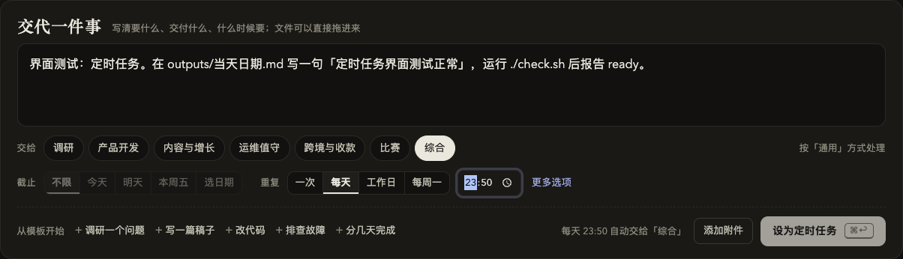
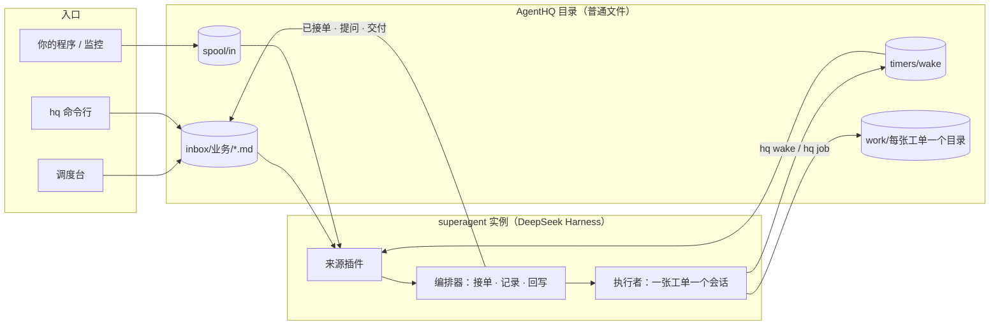

# AgentHQ

在自己电脑上 7×24 运行的多业务 AI 工单系统。你交代一件事，它开一张工单、派一个独立的执行者去做，做完把结果写回原处，等你验收。一件事可以跨好几天：执行者自己记进度、到点醒来接着做，需要你决定时才来问你。

它建在 [dsh-superagent-prototype](https://github.com/deepseek-ai/dsh-superagent-prototype)（DeepSeek Harness 的工单编排插件）之上，补了三样东西：

- **不依赖 GitHub 的来源**：Markdown 笔记收件箱、定时任务和唤醒、给程序用的 JSON 投递目录（`patches/`）。
- **按业务组织**：每个业务一个收件箱文件夹、一份业务规则、一种默认做法（调研、写代码、写内容、运维、通用），每种做法有自己的工单模板和交付自检脚本。
- **调度台**：一个本机网页，交任务、回答问题、看进展、预览交付、验收，都在一处；外加 `hq` 命令行和看门狗。

[English summary](README.en.md)



## 它怎么工作



1. 你在调度台写下要做的事，它变成 `inbox/<业务>/` 下的一篇 Markdown 笔记。
2. 收件箱来源读到笔记，编排器开一张工单；`bin/hq-prepare` 用通用规则 + 业务规则 + 做法模板建好工单目录。
3. 执行者在目录里干活，进展写进 `STATE.md`；要等就 `hq wake` 约好时间，长命令用 `hq job` 放后台。
4. 要你决定时问题写回笔记，调度台"需要你"里出现这一条；你的回复由同一个执行者接着处理。
5. `check.sh` 通过后交付写回笔记，你点"验收通过"。

详细流程见 [docs/architecture.md](docs/architecture.md)。

## 快速开始

需要 macOS 或 Linux、Node.js 22.19+、pnpm、git、tmux、python3、sqlite3，以及 DeepSeek Harness：

```sh
npm install -g @deepseek-ai/dsh@0.2.1-rc.3
git clone <this repo> agenthq && cd agenthq
export DEEPSEEK_API_KEY=sk-...        # 或写进 ~/.dsh/.credentials.yaml，见 docs/models.md
node scripts/setup.mjs --owner me --name 我 --preset solo
```

`setup.mjs` 会：按预设写 `hq.config.json` 和业务规则，克隆 dsh-superagent 并打补丁、构建，建一个 DeepSeek Harness profile，启动实例，推送设置，安装调度台和看门狗为常驻服务，把 `hq` 放进 `~/.local/bin`。打开 <http://127.0.0.1:3090/> 就能用。

预设（`--preset`）：

| 预设 | 业务 |
|---|---|
| `minimal` | 综合 |
| `solo` | 调研、产品开发（写代码）、内容与增长、运维值守、综合，每天 08:30 早报 |
| `content-studio` | 调研、内容、综合，每天选题早报 |
| `shop` | 店铺与跨境、内容、运维值守、综合 |

预设只是起点，按自己的业务改：[docs/businesses.md](docs/businesses.md)。

## 文档

| 文档 | 内容 |
|---|---|
| [docs/install.md](docs/install.md) | 依赖、安装选项、手动安装、卸载 |
| [docs/businesses.md](docs/businesses.md) | **按你的业务搭建**：业务、做法模板、规则、定时任务、程序接入、提问边界 |
| [docs/dashboard.md](docs/dashboard.md) | 调度台用法、`hq` 命令、调度台 API |
| [docs/models.md](docs/models.md) | DeepSeek 官方 API、任意 OpenAI 兼容接口、联网搜索、并发 |
| [docs/architecture.md](docs/architecture.md) | 组件、一件事的完整生命周期、文件布局、状态怎么判断 |
| [docs/operations.md](docs/operations.md) | 常驻、看门狗、备份、升级、手机访问、安全、排错 |
| [patches/README.md](patches/README.md) | 对 dsh-superagent 的改动和怎么跟进上游 |

## 安全边界

- 调度台和实例只监听 127.0.0.1，调度台不需要登录、不调用模型。不要把端口直接暴露到公网（远程访问见 docs/operations.md）。
- 只有你交代的事、定时任务、名单里的程序消息会开工单；它不会自己找活。
- 执行者用你的系统账号运行，`blockedCommands` 里的命令（默认 sudo、钥匙串、云部署、支付等）它用不了。公开发布、对外发送、付款、部署、推送或改主分支、删除工单目录以外的东西、需要密钥或花钱，都会先问你。代码只提交到 `agent/` 分支。

## 许可证

MIT，见 [LICENSE](LICENSE) 和 [NOTICE](NOTICE)。
