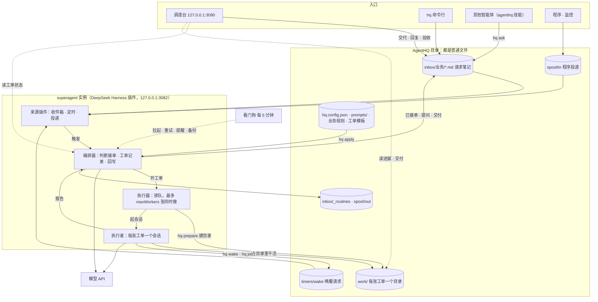

# 架构

思路：每个请求先落成一个普通文件，superagent 实例读到文件就开工单、派执行者去做，做完把结果写回原来的文件。调度台把这些文件和工单状态合在一起给人看。



## 组件

| 组件 | 在哪 | 做什么 |
|---|---|---|
| superagent 实例 | `vendor/dsh-superagent`（打补丁的 dsh-superagent），跑在 tmux 会话 `dsh-<profile>` | 来源插件把文件变成触发；编排器（Router 是一个模型会话）判断接单、记录工单、把回复写回；执行器排队并为每张工单起一个执行者会话。工单记录在 `~/.dsh/state/<profile>/orchestrator.sqlite` |
| 来源插件 | `patches/` | `inbox`：每个业务一个文件夹的 Markdown 笔记；`timer`：cron 定时任务和工单唤醒；`spool`：程序的 JSON 投递目录 |
| `bin/hq-prepare` | 实例的 prepare 命令 | 每张工单开工前建目录：通用规则 + 业务规则 + 做法模板拼成 `AGENTS.md`，复制 `STATE.md` 和 `check.sh`，链接业务 `knowledge/`；代码工单在仓库里建 `agent/<工单名>` 分支的工作树 |
| `bin/hq` | `~/.local/bin/hq` | 交任务、看状态、推配置；执行者用它登记唤醒和后台作业 |
| 调度台 | `lib/hub.mjs` + `lib/hub/` | 本机网页和 API，把笔记和工单合成"请求"（`lib/requests.mjs`） |
| 看门狗 | `lib/watchdog.mjs`，launchd / systemd 每 5 分钟 | 实例挂了重启（每小时最多 3 次）；暂时性失败自动重试（每张最多 2 次）；工单 3 小时没进展发提醒；每天备份工单数据库（保留 14 天） |
| 配置 | `hq.config.json`、`prompts/` | `hq apply` 经实例的管理接口推送；以文件为准 |

## 一件事的生命周期

1. **交出**：调度台、`hq ask` 或其他智能体在 `inbox/<业务>/` 写一篇笔记；程序往 `spool/in/` 放 JSON；定时任务到点由定时来源发起。
2. **接单**：收件箱来源发现笔记、等它停止改动 10 秒后读入。笔记作者是 `owner`，属于明确请求，编排器开工单。程序消息看发送者：`person` 直接开，`bot` 交给规则判断（`eval.mode`）。
3. **准备**：执行器排到它，`hq-prepare` 建好 `work/<名字>-<编号>/`。
4. **干活**：执行者先在笔记里回一句"已接单"，然后在工单目录里做，进展记进 `STATE.md`。
5. **问你**：需要决定时，问题写回笔记，工单停在"等你回答"。你的回复追加在笔记末尾，收件箱来源读到后交给同一个执行者。
6. **跨时段**：`hq wake` 在 `timers/wake/` 写一个唤醒请求，执行者结束这一轮；`hq job` 把长命令放到后台，结束时自动唤醒。时间到、文件出现或截止时间到，定时来源把工单叫醒，执行者读 `STATE.md` 接着做。
7. **交付**：`check.sh` 通过后，执行者报告 ready，结论和交付路径写回笔记，工单结束。定时任务的结果写进 `inbox/_routines/`，程序的回复写进 `spool/out/`。
8. **验收**：笔记标上 `status: done`。再补充一段会重新打开笔记，同一张工单接着做。

## 调度台怎么判断状态

调度台不保存状态，每次从笔记和工单推出来（`lib/requests.mjs`）：

- 笔记和工单靠线程键 `inbox:<业务>/<笔记相对路径去掉 .md>` 对应。
- 工单未结束：处理中 / 排队中；在等人时按原因分为等你回答、受阻、失败了、消息没送到；你写了新的一段但执行者还没收到时是"已补充，等待处理"；其余是"等待中"，有唤醒请求就显示下次时间。
- 工单已结束：笔记标了 done 是"已验收"，否则按结果分为待验收、无需处理、已停止。
- 没有对应工单的新笔记：10 分钟内是"已提交"，之后是"没有接单"。

## 文件布局

```
bin/hq, bin/hq-prepare           命令行、工单准备脚本
lib/                             配置推送、状态汇总、调度台、看门狗
hq.config.json                   你的配置（setup 生成，不进版本库）
hq.config.example.json           配置的完整例子
presets/<名字>/                  预设：业务列表、定时任务、发送者、规则和业务规则
shared/AGENTS.md                 所有工单的通用规则
businesses/<id>/AGENTS.md        业务规则；knowledge/ 业务资料（不进版本库）
templates/<做法>/                工单模板：AGENTS.md、STATE.md、check.sh
prompts/                         实例的团队提示词和执行者提示词覆盖
patches/                         对 dsh-superagent 的补丁
profile/                         DeepSeek Harness profile 的配置模板
service/                         launchd / systemd 模板
skill/                           给其他智能体的 agenthq 技能
scripts/setup.mjs                安装
inbox/ spool/ timers/ work/ state/   运行数据（不进版本库）
```

工单目录（非代码）：

```
work/<名字>-<编号>/
  AGENTS.md      拼好的规则（通用 + 业务 + 做法 + 这张工单的信息）
  STATE.md       进度记忆
  check.sh       交付自检
  outputs/       交付物
  knowledge -> businesses/<id>/knowledge
  .hq/ticket.json  工单元信息；.hq/jobs/ 后台作业
```

每个工单目录是独立的 git 仓库，执行者的每步改动都有记录。
